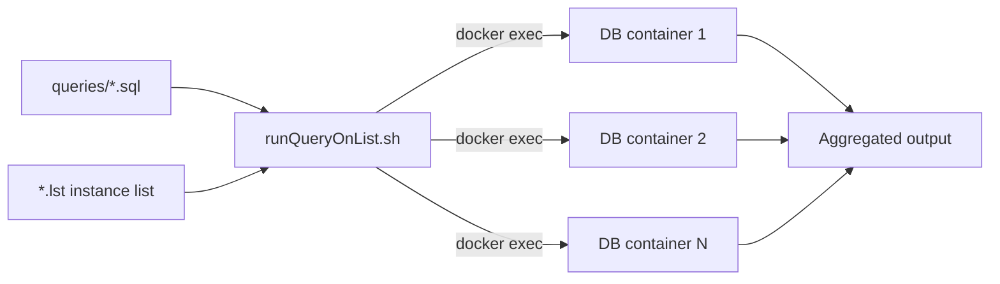

# dbScripts

Bash scripts to run SQL queries against multiple OJS (Open Journal Systems) database containers in batch. Designed for multi-journal deployments where the same query must be executed across many instances for audits, reports or diagnostics.

## What it does

<i class="fa-solid fa-database"></i> Runs the same SQL query against N containers.
<i class="fa-solid fa-list"></i> Iterates over `.lst` instance lists.
<i class="fa-solid fa-file-code"></i> Keeps queries as versioned `.sql` files.
<i class="fa-solid fa-shield-halved"></i> Excludes credentials via `.gitignore`.

## Flow



## Layout

```text
dbScripts/
├── queries/             SQL query files
├── runQueryOnList.sh    Batch query runner
├── allProduction.lst    Production instance list
├── testJournals.lst     Test instance list
├── .gitignore
└── LICENSE
```

## Usage

```bash
# Run a query against all production instances
./runQueryOnList.sh queries/subscriptions_report.sql allProduction.lst

# Run against the test environment
./runQueryOnList.sh queries/check_plugins.sql testJournals.lst
```

## Add a query

1. Create a `.sql` file inside `queries/`.
2. Run it with `runQueryOnList.sh` against the target list.

## Add an instance list

Create a `.lst` file with one instance per line (container name or configured alias).

## Requirements

<i class="fa-brands fa-linux"></i> Bash 4+
<i class="fa-brands fa-docker"></i> `docker`
<i class="fa-solid fa-database"></i> SQL client inside containers (`mysql`, `mariadb` or `psql`)

## Security

<i class="fa-solid fa-lock"></i> Do not commit credentials. Use `.gitignore` and external config or environment variables.
<i class="fa-solid fa-triangle-exclamation"></i> Restrict usage to controlled environments.

## License

See `LICENSE`.
